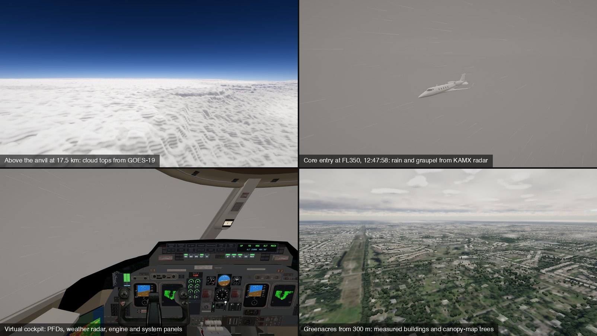

# N722BD: Learjet 60 convective upset simulator

A browser flight simulator that recreates the 1 November 2026 loss of Learjet 60 N722BD, which entered a thunderstorm
core at FL350 over Palm Beach County, and lets you try to fly it out. The storm is built from the real radar,
satellite and lightning data for those minutes. The airplane is a 6-DOF model checked against the Airplane Flight
Manual (AFM). It is pure WebGL2 and ES modules with no build step.

**[Fly it in your browser](https://shanebreazeale.github.io/machtuck/)**



> Nine people died on this flight. The cause is undetermined, and every upset scenario here is a hypothesis, not a
> finding. The crew's final transmissions are not reproduced in the game.

## Contents

[Features](#features) · [Installation](#installation) · [Usage](#usage) · [Controls](#controls) ·
[How it works](#how-it-works) · [Validation](#validation) · [Real data](#real-data) · [Development](#development) ·
[Contributing](#contributing) · [License](#license)

## Features

- **The real storm.** KAMX NEXRAD volumes drive the clouds, icing and the cockpit weather radar. GOES-19 sets the cloud
  tops, GLM flashes are replayed at their real times and places, and the KPBI METAR and KMFL sounding fill in the rest.
- **An airplane that fights back.** Mach tuck, shock buffet, ice on the wing and T-tail, unboosted controls with real
  column forces, an autopilot that trims against you, and Part 25 structural limits.
- **Four upset hypotheses.** Fly the combined convective-core case, a tailplane stall, Mach tuck with a failed Mach
  trim, or a runaway nose-down trim, each "as flown" or in a forgiving trainer mode.
- **A reconstruction mode.** Watch the reported ADS-B track replayed with chase, cockpit and ground cameras.
- **A debrief.** Compares your flight with the real one and exports a 4 Hz flight data recorder as CSV.
- **A physically based renderer.** Atmosphere scattering, volumetric clouds, imagery-driven ground with 62,000 real
  buildings and 512,000 measured trees around the impact area.

## Installation

Nothing to install or build. Clone the repository and serve it with any static file server:

```bash
git clone https://github.com/ShaneBreazeale/machtuck.git
cd machtuck
python3 -m http.server 8080
```

Then open http://localhost:8080.

You need a WebGL2 browser with `EXT_color_buffer_float`, which every current desktop browser has. A discrete GPU or
Apple Silicon is recommended. Press `K` to trade quality for frame rate.

## Usage

Click **Fly it**, or press `N` to skip ahead to core entry. The autopilot flies the cruise and hands you the airplane
when it can no longer cope.

## Controls

| Action | Keyboard | Controller |
|---|---|---|
| Pitch and roll | Arrow keys or WASD, or drag the mouse. Down or S pulls. | Left stick |
| Rudder | Q / E | Right stick |
| Throttle | `-` / `=`, `0` for idle | R2 / L2, square for idle |
| Pitch trim | `,` nose-down, `.` nose-up | R1 / L1 |
| Autopilot off or on | X | Cross |
| Spoilers, gear, flaps | B, G, F | Circle, D-pad |
| Camera | C, right-drag to orbit | Triangle |
| Tablet (map and procedure cards) | Tab, then 1 to 6 for a card | |
| Real weather on or off | U | |
| Pause, restart, sim rate | P, R, `[` `]` | Options |
| Controls and hardware binding | / | |
| All keys | H | Create |

**Flight hardware.** Yokes, joysticks, rudder pedals and throttle quadrants work through the browser's Gamepad API, several
at once, in Chrome and Firefox. Press `/`, or **Controls & hardware** on the briefing screen, then bind each function by
moving or pressing the control: pitch, roll, rudder, throttle lever, autopilot disconnect, trim (hat switch or buttons),
gear, flaps, spoilers, idle and camera. The direction you move a control on binding becomes its positive direction, and
its travel is the calibration. Bindings are saved per device name in the browser. An unbound yoke or stick flies on its X
and Y axes; pedals and quadrants do nothing until bound. A moved throttle lever sets the thrust levers directly, and
hardware axes skip the keyboard's smoothing ramp. Each device appears only after you press one of its buttons.

**Force feedback.** A USB PID force-feedback joystick (the DirectInput force-feedback standard) can drive the column in
Chrome or Edge over WebHID. Open the controls panel (`/`), choose **Connect force-feedback stick**, and pick the stick in
the browser's prompt. The stick's position then becomes the column's position, and its motor supplies the elevator
and aileron hinge moment. The stick gets stiffer with airspeed and transonic Mach, and goes light and pulses with a
stalled iced tail. With the autopilot engaged the stick follows the servo, and pushing past the clutch force makes it
slip. The stick shaker and buffet shake the stick. Your simulated strength still limits how far the elevator goes.
**Test** pulls the stick back, then moves it right, then shakes it; use invert or swap if the directions are wrong.
Start with low strength. The driver reads the report layout from each stick's HID descriptor, so no per-model profile
is needed. It has been tested only against simulated sticks, so behaviour on real hardware is unverified.

Without a force-feedback stick, your inputs are force on the column, not surface position. At high speed full deflection may take more than you can
hold, and nose-up trim is how you take the load off. The help screen (`H`) has the AFM upset-recovery card.

## How it works

### Flight model

The geometry, limits and performance data come from the Learjet 60 AFM (FM-123), the Gates Learjet wing patents, and
SAE 932534, which describes the Model 60 wing. Aerodynamics use textbook methods (component drag build-up, DATCOM lift
slope, sweep theory and a section pressure model for critical Mach, wave drag and buffet). The engine is a PW305A
two-stream cycle anchored at the design point in AIAA 90-2520.

Maximum lift versus Mach comes from the certified airspeed-limits chart in EASA type certificate data sheet
IM.A.212. Its maneuvering-speed lines mark where a full pull stalls the wing at the 3.0 g limit load, so each point
gives the maximum lift at that Mach. Twenty points over four weights fall on one curve that meets the AFM stall chart
near M 0.2.

### Control forces

The Learjet 60's ailerons and elevator are driven by cables and push-rods with no hydraulic boost, so
[`js/controls.js`](js/controls.js) treats your input as the force on the column. The surface moves until that force
balances its hinge moment, which grows with dynamic pressure and in the transonic range. The calibration follows the
AFM, which warns that a nose-down overspeed can need more than 75 lb to recover. A pilot holds about 60 lb, bursts to
150 lb, and tires within about 10 seconds. The autopilot's clutched servos can be overpowered, but it keeps trimming
against you until you disconnect it.

### Structure

Vmo/Mmo is an operating limit, not a structural one. Below the design dive speed, speed alone does no damage. Strength
follows the AFM limit load of +3.0 / −1.0 g, with failure at the 1.5× ultimate load. Past the design dive speed the
allowable loads shrink, and past the flutter margin failure is rapid. The design dive speed of 377 KIAS / M 0.89 is
not published anywhere. It is an estimate consistent with the Part 25 margins.

In the sim's breakups the killer is negative g. When the iced tail stalls, the pitch-down loads the wing to about
−2 g within seconds, past the ultimate load, while the airplane is still near M 0.81.

### Renderer

[`js/render.js`](js/render.js) and [`js/shaders.js`](js/shaders.js) form an HDR pipeline:

- **Atmosphere:** precomputed transmittance and multiple-scattering tables on a spherical Earth, with aerial
  perspective shadowed by the clouds. The sun comes from a solar ephemeris for the scenario clock.
- **Clouds:** a volumetric raymarch shaped by the radar and satellite data, eroded with GPU-baked noise, lit by a light
  march plus a cloud-shadow map.
- **Ground:** USGS aerial imagery on a spherical Earth with water, waves and sun glint. Below 1.8 km the photo drives
  ray-traced houses and trees. Over the impact area the buildings and trees are measured, not generated.
- **Aircraft:** the textured Premier Aircraft Design Learjet 60 with live control surfaces, gear and beacon, in the
  N722BD livery, drawn with 4× multisample anti-aliasing.
- **Post-processing:** temporal anti-aliasing and upsampling, bloom, sun glare, eye adaptation and an ACES tone map.
  Dynamic resolution keeps the frame rate near 55 fps.

[`docs/visual_comparison.md`](docs/visual_comparison.md) compares it with MSFS 2024 and X-Plane 12, feature by feature.

## Validation

Run `node test/flight_test.mjs` and `node test/afm_validate.mjs` to reproduce these.

| Check | Model | Reference |
|---|---|---|
| Clean and flapped stall speeds, 2 weights | within 2 kt | AFM Fig 5-22 |
| Buffet onset lift vs Mach | rms error 0.019 | SAE 932534 flight test |
| Max g at the 20 certified VA points | 2.90 to 3.11 g | 3.0 g, EASA TCDS IM.A.212 |
| Max-continuous N1 | rms ~1.5% | AFM Fig 5-31, 5-32 |
| Single-engine climb gradient | rms 0.7% | AFM Fig 5-62, 5-65 |
| Time to climb, MTOW to FL410 | ~18 min | 18 to 18.5 min published |
| NBAA IFR range, 4 passengers | 2,455 nm | 2,405 nm published |
| Max level speed | 458 KTAS | 453 to 466 KTAS published |

`node test/force_test.mjs` flies the upset with a force-limited pilot following the AFM procedure. Starting the
recovery 2 seconds after the autopilot lets go saves the airplane in three of the four hypotheses. At 5 seconds it
costs about 8,000 ft. From 8 seconds on, the wing fails before the pilot acts.

## Real data

| Data | Source | Used for |
|---|---|---|
| `data/kamx_*` | KAMX NEXRAD Level II at 17:40, 17:45 and 17:51Z, gridded to 500 m | Clouds, cores, icing, updrafts, weather radar |
| `data/goes/` | GOES-19 ABI visible and infrared, parallax-corrected | Cloud-top height and deck thickness |
| `data/glm_flashes.json` | GOES-19 Geostationary Lightning Mapper, 17:44 to 17:52Z | Lightning times and positions |
| `data/metar.json`, `data/sounding_kmfl.json` | KPBI METARs, KMFL 12Z radiosonde | Cumulus layer, deck base, freezing level |
| `data/ground/` | USGS orthoimagery (NAIP), NASA Blue Marble, USGS NHD water | Terrain texture and water |
| `data/ground/buildings.bin` | Overture Maps (OpenStreetMap + Microsoft) | 62,192 buildings with measured heights |
| `data/ground/trees.bin` | Meta / WRI 1 m canopy height map | 511,964 trees with measured heights and crowns |
| `audio/atc_liveatc.mp3` | LiveATC recording as publicly posted | Optional ATC audio, off by default |

Every dataset has a fetch script in [`tools/`](tools), for example:

```bash
python3 tools/grid_nexrad.py <Level2 file> data/kamx_HHMMSS
python3 tools/fetch_goes.py --out data/goes
python3 tools/fetch_buildings.py
```

## Development

Run the headless physics checks with Node 22:

```bash
for t in test/*.mjs; do node "$t" || echo "FAILED: $t"; done
```

Measure real-time frame rate in headless Chrome while the server runs on port 8080:

```bash
node tools/bench.mjs 2560x1320 8080
```

| Path | Contents |
|---|---|
| `js/aircraft.js`, `js/aero.js`, `js/engine.js` | Flight model, aerodynamics, engine cycle |
| `js/controls.js` | Column and wheel forces, pilot strength, autopilot clutches |
| `js/input.js`, `js/hardware.js`, `js/hwui.js` | Keyboard and mouse, all connected flight hardware, the binding panel |
| `js/ffb.js` | USB PID force-feedback driver over WebHID |
| `js/scenario.js` | Storm environment, ADS-B reconstruction, ATC timeline, autopilot, hypotheses |
| `js/render.js`, `js/shaders.js` | WebGL2 renderer |
| `js/hud.js`, `js/cockpit.js`, `js/vcgauges.js` | Instruments, 3D cockpit, standby gauges |
| `test/` | Flight-test card, AFM table validation, upset, recovery, force, hardware and force-feedback checks |
| `tools/` | Data fetchers, model and livery converters, benchmark |

Debug views load the reconstruction paused at a given time:

- `#view=t,cam,orbitYaw,orbitPitch` uses a sim camera (0 cockpit, 1 chase, 2 ground).
- `#shot=x,y,z,yaw,pitch,fov,nexrad,t` uses a free camera in metres from KPBI (x east, y up, z north).

## Contributing

Issues and pull requests are welcome, especially better sources: photos of N722BD for the livery, or published Learjet 60
data that can replace an estimate. Run the test suite before opening a pull request, and keep every number traceable to
a source or marked as an estimate.

## Sources and credits

The timeline comes from the Flightradar24 blog, a BizJet Journal ADS-B Exchange analysis, NEXRAD analyses by MyRadar and
LiveStormChasers, LiveATC recordings, and the NTSB briefing of 2 November 2026. All figures are provisional.

The aircraft and cockpit models are the FSX Bombardier Learjet 60 by Premier Aircraft Design (Jean-Pierre Brisard,
Barry Blaisdell, Bob May and Kevin Pardy), converted by `tools/fs9_ext.py` and `tools/fs9_vc.py`. See
[`data/vc/README.md`](data/vc/README.md).

## License

Third-party data keeps its own terms:

- USGS and NASA imagery and NOAA weather data are public domain.
- The Overture buildings are © OpenStreetMap contributors and Microsoft, under ODbL 1.0.
- The canopy height data is by Meta and the World Resources Institute, under CC BY 4.0.

The repository does not include a license file for its own code yet.
